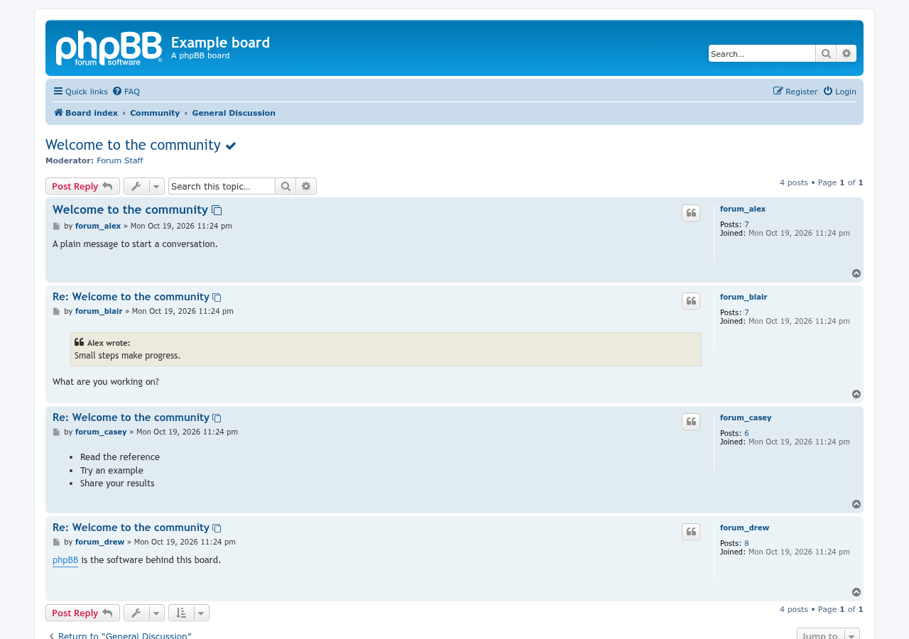
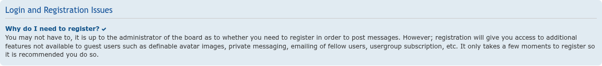
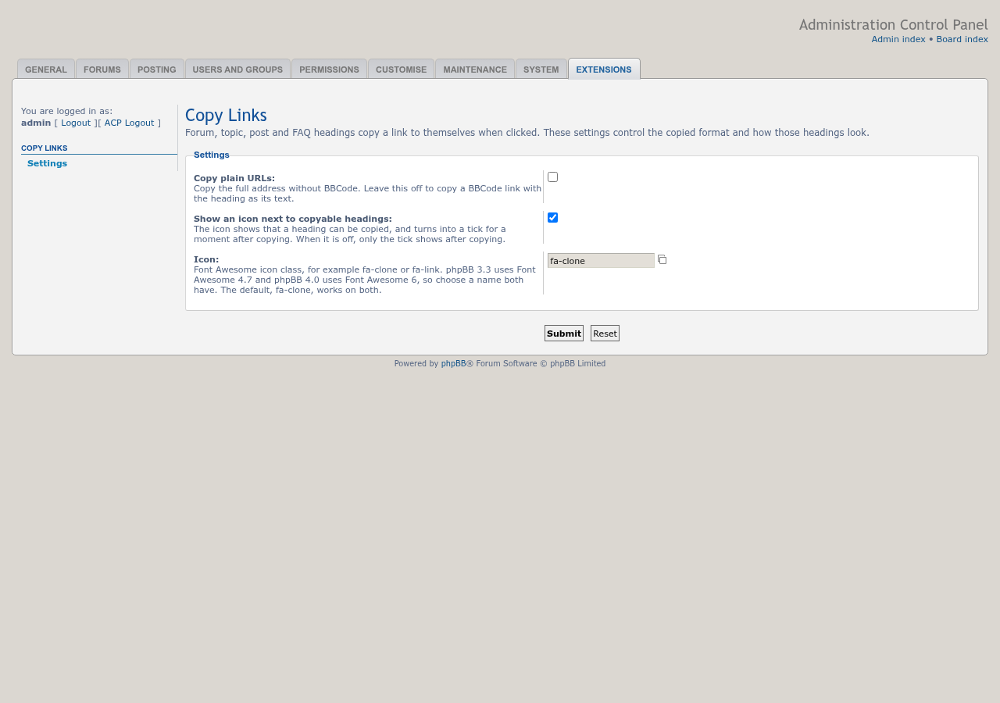

# Copy Links

 

Click a forum, topic, post or FAQ heading to copy a link to it, ready-made as BBCode.

## Features

- Click a forum or topic title, a post subject, or a question in the FAQ or BBCode guide, and a link to it is copied as BBCode, for example `[url=https://example.com/forum/viewtopic.php?t=42]Topic title[/url]`. Paste it into a post and it shows as a readable link.
- Code blocks have a separate **Copy code** button beside **Select all**. It copies plain text, preserving indentation and line breaks, and provides visible and screen reader feedback. If copying is blocked, the code is selected for manual copying. The ACP link-format setting does not affect code copying.
- Also works on the title above the posting form and on the posts in the topic review below it.
- Links are full addresses built from the forum, topic or post ID, so they work anywhere they're pasted and never carry a session ID. They always point at the forum, topic or post itself, not a page of it.
- A small icon (Font Awesome `fa-clone` by default) marks each copyable heading and turns into a tick for a moment after copying. Screen readers announce "The link has been copied."
- Built for keyboard and screen reader use: headings stay ordinary links reached with Tab and copied with Enter, each one has a description matching the selected copy format, the icon is hidden from screen readers, and focus is always clearly outlined.
- Clicking a post or FAQ question also follows its anchor and keeps the link focused.
- Ctrl-, Cmd-, Shift- and middle-clicks still open the link as usual.
- When the browser won't allow copying (for example a board on plain `http://`), the selected link format is shown in a box to copy by hand.
- Search engine bots get the board unchanged.
- Choose BBCode (the default) or plain URLs, turn the icon on or off, or choose another icon, under **ACP → Extensions → Copy Links → Settings**.
- Works with prosilver and styles based on it.

## Screenshots

<table>
<tr>
<td></td>
<td></td>
<td></td>
</tr>
</table>

Click an image for the full size. See the [screenshot gallery](docs/images/screenshots/README.md) for the rest.

## Requirements

- phpBB 3.3.19 or later, including phpBB 4.0
- PHP 8.3.36 or later

## Installation

1. Copy the extension to `/ext/phpbbmodders/copylinks`
2. In the Administration Control Panel, go to **Customise → Manage extensions**
3. Enable the **Copy Links** extension

After updating an existing installation, disable and re-enable the extension to apply the new settings migration; do not delete its data.

## Contributing

Contributions are welcome!

- **Bug reports**: [Open an issue](https://github.com/phpbbmodders/copylinks/issues).
- **Everything else** (questions, feature requests, ideas, general discussion): [Use Discussions](https://github.com/orgs/phpbbmodders/discussions), or the [community forum](https://www.phpbbmodders.com/community/).
- Pull requests are welcome for bug fixes or discussed features.

## Acknowledgments

- Based on [Click/tap/Enter to copy pre-formatted links](https://www.phpbb.com/community/viewtopic.php?t=2676238), style code shared on phpBB.com by Gumboots, which itself grew out of the older Post Numbers extension.
- Code review, bug fixes, and documentation assisted by [Claude](https://www.anthropic.com/claude) and [Codex](https://openai.com/codex/).

## License

This extension is licensed under the **GNU General Public License v2.0**.

See [license.txt](license.txt) for more information.
