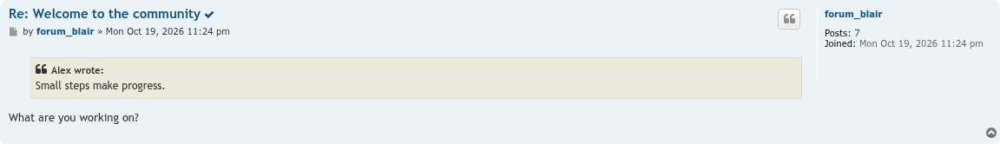

# Copy Links screenshots

Taken on phpBB 3.3 with prosilver, using `phpbb-test-board/screenshots.py` from [phpbb-release-tools](https://github.com/phpbbmodders/phpbb-release-tools), on a board filled with seed-forum's standard fixtures, with the default settings. Copyable headings show an icon (`fa-clone`), which turns into a tick for a moment after a copy; each board screenshot is taken just after a click, while the tick shows. Click an image for the full size.

## Topic title

Clicking the title above a topic copies a link to the topic. The post subjects below still show the icon.

## Post subject

Clicking a post's subject copies a link to that post.

## FAQ question

Clicking a question in the FAQ copies a link to that question.

## ACP settings

**Extensions → Copy Links → Settings**: turn the icon on or off, and choose which Font Awesome icon it is. With the icon off, only the tick shows after a copy.

