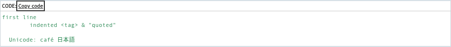
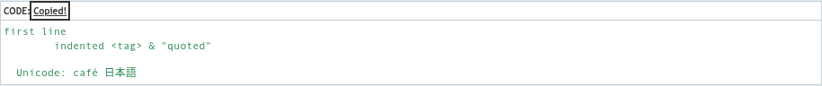
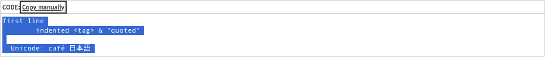

# Copy Links update screenshots — 10/25/2026

Recent changes in the rolling `1.0.0-dev` build. The complete screenshot gallery
remains at [docs/images/screenshots/README.md](../../images/screenshots/README.md).

Captured on phpBB 3.3 with prosilver and seed-forum fixtures using
`tests/browser/capture_update.py`, which reuses phpbb-test-board’s screenshot
tool. Clipboard success and failure are controlled for reproducible feedback
states. The PNGs retain their original resolution.

## Copy code control

Copy code replaces Select all when JavaScript runs, leaving one control. With JavaScript off, the original Select all link remains. Keyboard focus stays visible.

## Successful copy

The button shows Copied! after plain code is copied. Indentation and line breaks are preserved.

## Manual-copy fallback

When clipboard access is unavailable, the code is selected and the button shows Copy manually.

